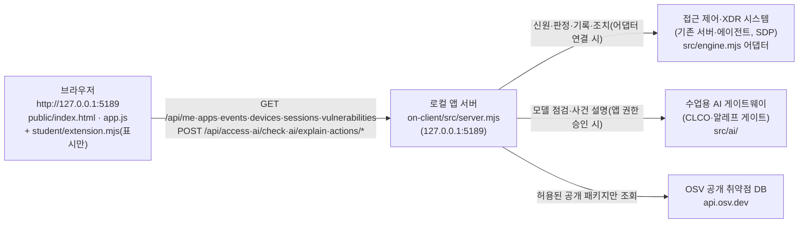

# 름셰브 학생 실행 설명서·시스템 구성도 (21단계)

작성: 장아름(reum2kr) · 대상: 이 프로젝트를 처음 받아 실행해 볼 사람
이 문서는 학생이 새로 쓴 문서입니다. 제공 문서(README.md 위쪽, docs/의 다른 파일)는 고치지 않았습니다.

표기 규칙: **확인함(PC)** = 내 Windows PC에서 직접 실행해 본 것, **확인함(모의)** = 예제 서버·모의 입력으로만 점검한 것, **코드만** = 코드를 읽어 확인한 것, **미확인** = 실행해 보지 못한 것.

## 1. 목적과 기능

직원이 자기 로그인 상태, 업무 앱 접근 판정, 본인 접속 기록·XDR 경보, AI 사건 설명, 조치 상태, 설치 패키지 취약점 조회 결과를 한 화면에서 보는 보안 Agent 앱입니다. 앱은 내 PC에서만 열리는 로컬 서버(`127.0.0.1`)로 실행됩니다.

## 2. 필요 프로그램과 실제로 확인한 버전

| 항목 | 수업 기준 | 내가 확인한 값 | 근거 |
|---|---|---|---|
| 운영체제 | Windows | Windows (PowerShell·파일 탐색기 사용) | 확인함(PC) |
| Node.js | 24.19.0 (`package.json` engines, 22~24 허용) | **v24.22.0** — 실행 도구가 「참고: 수업 기준은 v24.19.0」을 띄우지만 그대로 실행됨 | 확인함(PC) |
| npm 의존성 | 없음(외부 패키지 설치 불필요) | `npm install` 없이 실행됨 | 확인함(PC) |
| Git 클라이언트 | 아무것이나 | GitHub Desktop으로 Fetch·Pull | 확인함(PC) |
| 브라우저 | 1280px 이상 | Chrome/Edge 계열 | 확인함(PC) |

## 3. 폴더 구조 (Git 최상위 = 프로젝트 폴더)

```
choi-bujang-secret-vault_1/          ← Git 저장소 최상위(1~12단계 자료실 파일도 함께 있음, 손대지 않음)
└─ on-client/                        ← 앱 폴더. 여기서 PowerShell을 열고 실행
   ├─ package.json                   ← scripts: start · demo · check, engines node 24.19.0
   ├─ .env.example                   ← 비밀 없는 설정 견본(ON_PORT=5189 등). 실제 .env는 커밋 안 함
   ├─ tools/start-alekov.ps1         ← 실행 도구(Node 버전·폴더·포트 확인 후 src/server.mjs 실행)
   ├─ src/server.mjs                 ← 로컬 앱 서버(제공). /api/* 경로 처리
   ├─ src/engine.mjs, src/engine/    ← 기존 서버·에이전트(SDP) 연결 어댑터(제공)
   ├─ src/ai/                        ← 수업용 AI 게이트 연결(제공)
   ├─ src/actions/                   ← 조치 준비·집행·결과 재조회(제공)
   ├─ src/vulnerabilities/           ← package-lock 읽기·OSV 조회(제공)
   ├─ public/                        ← 브라우저 화면(index.html, app.js 등, 제공)
   ├─ student/extension.mjs          ← ★ 학생 작성(13~20단계 표시 함수 8개)
   └─ docs/STUDENT_RUNBOOK.md        ← ★ 학생 작성(이 문서)
```

## 4. 실행 절차

1. GitHub Desktop에서 `choi-bujang-secret-vault_1`을 **Fetch origin → Pull origin** 합니다. History 맨 위가 최신 커밋인지 봅니다. (확인함(PC))
2. **Repository → Show in Explorer**(Ctrl+Shift+F)로 폴더를 열고 `on-client` 폴더로 들어갑니다.
3. 빈 곳에서 마우스 오른쪽 버튼 → **터미널에서 열기**. 프롬프트가 `...\choi-bujang-secret-vault_1\on-client>`인지 봅니다. 상위 폴더에서 열렸다면 `cd on-client`를 먼저 입력합니다. (확인함(PC))
4. 실행 명령(기본: 실제 연결 확인 모드):
   ```powershell
   powershell -NoProfile -ExecutionPolicy Bypass -File .\tools\start-alekov.ps1
   ```
   예제 자료로만 볼 때는 끝에 ` -Demo`, 포트를 바꿀 때는 ` -Port 5190`, 창 없이 실행할 때는 ` -Background`를 붙입니다(`tools/start-alekov.ps1`의 매개변수, 코드만 — PC에서는 기본 모드만 실행해 봄). `npm start`(= `node src/server.mjs`)와 `npm run demo`(= `--demo`)도 같은 서버를 켭니다.
5. **정상 시작 신호**(확인함(PC), 기본 모드):
   ```
   케셰브 연결 확인: http://127.0.0.1:5189
   케셰브가 켜졌습니다. 브라우저에서 http://127.0.0.1:5189/ 을 여세요.
   서버가 응답한 것만 확인했습니다. AI 연결 상태는 화면에서 따로 확인해 주세요.
   끄려면 이 창에서 Ctrl+C 를 누르세요.
   ```
   이 신호는 내 PC 서버가 응답했다는 뜻이며, 회사 시스템이나 AI 연결 성공이 아닙니다.
6. 브라우저 주소: **http://127.0.0.1:5189/** → 왼쪽 메뉴 「보호 현황」「업무 앱」「보안 기록」.
7. **종료**: 실행한 PowerShell 창에서 `Ctrl+C`. (`-Background`로 켰다면 안내된 프로세스 번호의 node를 작업 관리자에서 종료)
8. **재실행**: 같은 `on-client` 폴더에서 4번 명령을 다시 실행합니다. 코드를 Pull 받은 뒤에는 반드시 끄고 다시 켭니다.

## 5. 시스템 구성도



같은 내용을 글로(ASCII):

```
[브라우저: public/app.js + student/extension.mjs]
        │  HTTP (127.0.0.1:5189, 같은 PC 안)
        ▼
[로컬 앱 서버: on-client/src/server.mjs]
        ├──▶ [접근 제어·XDR 시스템(SDP)]  : /api/me, /api/access, /api/events, /api/devices, /api/sessions, /api/actions/*
        │       어댑터가 없으면 ENGINE_NOT_CONNECTED(503) — 기본 실행이 이 상태
        ├──▶ [수업용 AI 게이트웨이]        : /api/ai/check, /api/ai/explain (권한 준비 전에는 ON_AI_PROVISIONING_PENDING)
        └──▶ [OSV]                          : /api/vulnerabilities (승인 목록이 비면 외부 조회 안 함 → not_configured / not_checked)
```

| 연결 | 누가 보내나 | 무엇을 | 키·비밀 위치 |
|---|---|---|---|
| 브라우저 → 로컬 서버 | 제공 화면(public/app.js) | 위 `/api/*` 요청. 학생 코드는 `api.get`으로 허용된 GET 6개만 가능, POST 없음 | 없음 |
| 로컬 서버 → 접근 제어·XDR | 서버(src/engine.mjs) | 신원·판정·기록·조치 | 담당자가 안내한 프로젝트 밖 설정 파일(문서·커밋에 없음) |
| 로컬 서버 → AI 게이트웨이 | 서버(src/ai/) | 모델 점검·사건 설명 | 앱 전용 보관함(화면 승인 절차로 저장, 문서·커밋에 없음) |
| 로컬 서버 → OSV | 서버(src/vulnerabilities/) | 허용된 공개 패키지 이름·버전 | 없음(공개 API) |

## 6. 제공 코드와 학생 작성 부분의 경계

| 구분 | 파일 | 내용 |
|---|---|---|
| 제공(수정 안 함) | `src/**`, `public/**`, `tools/**`, `docs/`의 기존 문서, `package.json`, `.env.example` | 서버, 요청·검증·취소·재요청 버튼, 늦은 응답 차단, 집행·확인 티켓 |
| 학생 작성 | `student/extension.mjs` | 받은 값을 글로 보여 주는 표시 함수 8개(createElement·textContent만, 버튼·POST 없음) |
| 학생 작성 | `docs/STUDENT_RUNBOOK.md`, `README.md` 맨 아래 학생 부분 | 이 문서 |

## 7. 구현한 함수와 확인한 기능

| 단계 | 함수(student/extension.mjs) | 보여 주는 것 | 확인 수준 |
|---|---|---|---|
| 13 | `renderIdentity` | 사용자·현재 기기·세션과 본인 기기·세션 목록, 상태 한국어+원래 값, 오류 시 이전 사용자 값 제거 | 확인함(PC): 연결 실패·다시 불러오기, 세 메뉴 마우스·키보드 이동 / 확인함(모의): 값 변경 |
| 14 | `renderDecision` | 접근 허용·거부·추가 확인·확인 불가, 판정 이유·시각, 요청 실패≠거부 | 확인함(모의) |
| 15 | `renderEvents` | 최신순 기록, 「기록 종류」「업무 앱」「접속 상태」 필터, 「<id> 상세」 | 확인함(PC): 조회 실패 화면 / 확인함(모의): 필터·상세·빈 목록 |
| 16 | `renderStatus` (+ 15 상세의 「<action> 미지원」) | 기기·세션 불러오는 중/빈 목록/실패, 알림, 도움정보 6개 값과 「도움정보 복사」 | 확인함(모의): 복사 내용 6줄·빈 목록·실패·시간 초과·자동 재요청 0건·미지원 버튼 / PC 화면은 미확인 |
| 17 | `renderAiConnection` | 점검 전·중·test/verified·모델 수·시각, 원인별 오류, 사건 설명 미실행 안내 | 확인함(모의) / 실제 연결 미확인 |
| 18 | `renderExplanation` | 참고용 AI 요약, 근거 ID 대조, 규칙, 확인 불가 상태, 제안·미실행 | 확인함(모의) / 실제 AI 설명 미확인 |
| 19 | `renderAction` | idle~error 상태 구분, ACK≠효과, effectApplied=true일 때만 효과 확인 | 확인함(PC): idle 화면 / 확인함(모의): 나머지 상태 |
| 20 | `renderVulnerabilities` | 조회 전·중·실패, complete~unverifiable, lock 정보, 패키지 정확한 버전·취약점 ID | 확인함(모의): not_configured·partial·실패·취소 |

## 8. 오류별 확인 순서

| 화면·창의 메시지 | 뜻 | 확인 순서·복구 | 관련 코드 |
|---|---|---|---|
| `Node.js 가 없습니다` | Node 미설치 | nodejs.org에서 24 LTS 설치 → PowerShell 새로 열기 → `node --version` | tools/start-alekov.ps1 |
| `포트 5189 를 다른 프로그램이 쓰고 있습니다` | 포트 사용 중 | 다른 프로그램은 두고 ` -Port 5190`으로 실행, 주소도 :5190 | tools/start-alekov.ps1 |
| `앱 폴더가 아닙니다` | 상위 폴더에서 실행 | `cd on-client` 후 다시 실행 | tools/start-alekov.ps1 |
| `연결 실패 … [ENGINE_NOT_CONNECTED]` | 접근 제어·XDR 어댑터 미연결(기본 실행) | 정상적인 미연결 상태. 담당자 안내 전에는 예제는 ` -Demo`로 확인 | src/engine.mjs, server.mjs |
| `연결 실패 … [NETWORK_ERROR]` | 앱 서버가 꺼짐 | PowerShell 창이 살아 있는지 확인 → 다시 실행 → 「다시 불러오기」 직접 클릭 | public/app.js, student 함수 |
| `…(시간 초과) [TIMEOUT/ENGINE_TIMEOUT]` | 응답 지연 | 잠시 뒤 「다시 불러오기」를 직접 누름(자동 재요청 없음) | renderStatus |
| `확인 불가(응답 형식 불일치) [CONTRACT_MISMATCH]` | 응답 형식 검증 실패 | 정상·빈 목록으로 보지 않음. 도움정보 복사 후 강사에게 | 각 render 함수 |
| `권한 준비 중·확인 불가 [ON_AI_PROVISIONING_PENDING]` | AI 앱 권한 미발급 | 학생 잘못 아님. 담당자에게 계정 연결·앱 권한 확인 | renderAiConnection |
| `조회 준비 미완료(not_configured)` / `아직 조회 안 함(not_checked)` | 조회 대상·허용 패키지 미설정 | 운영자 준비 사항. 설정을 임의로 바꾸지 않음 | renderVulnerabilities |

## 9. 미확인 기능(확인했다고 적지 않음)

- 실제 회사 시스템(SDP) 연결 상태의 사용자·판정·기록: 미확인(어댑터 미연결, `ENGINE_NOT_CONNECTED`).
- 수업용 AI 실제 연결 승인·verified 점검·실제 사건 설명: 미확인(권한 준비 전, 유료 요청 반복 안 함).
- 실제 조치 준비·집행·효과 관측: 미확인(지원 조치 없음, 시험 집행 안 함).
- OSV 실제 조회 결과(패키지 행): 미확인(허용 패키지 없음).
- Node.js 24.19.0 정확한 버전에서의 실행: 미확인(24.22.0에서만 확인).
- macOS·Linux에서의 실행 도구(`.ps1`): 미확인·미지원 범위.
